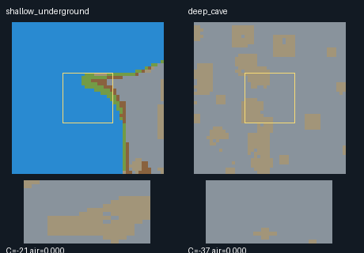
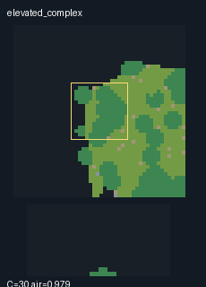

GO — Static逐整数高度、世界坐标Capture及有限真实样例验证通过；不代表正式1K/100K验收。

# Static Height-Adaptive Sampling / 2026-11-17

依据用户《Static Height-Adaptive Continuous Sampling Revision》。编码前已pull最新master `7c40d7e3e83f8b6bc9d83dda5797c7e1db40d670`；核验期间该版本加本次未提交改动，原生metadata如实保留worktree dirty。Craftium固定`ca8b2762aea46d10a88c53f6411ff1f0dbdf3b49`、VoxeLibre固定`178c71b1e7d6ec35c0d9c481c55eb306d6f330bc`。无模型、训练或GPU服务器访问。

## 高度公式

S为Native实际表层参考，C为中心16³的中心高度，起点O=C−8。完整Region=[C−24,C+23]⊆[-62,193]，所以C∈[-38,170]。

| Stratum | 连续整数中心区间（全部再裁到[-38,170]） | 附加条件 |
|---|---|---|
| Surface | [S−7,S+8] | 16³包含S |
| Elevated | [S+9,170] | C−8>S；0.10≤Air<0.98 |
| Shallow | [S−24,S−8] | 不是全`mcl_core:void` |
| Deep (`deep_cave`) | [-38,S−32] | 不是全Void，不要求洞穴 |

每地点最多16次，无放回均匀整数选择。Elevated过于空旷后上界降到C−1，低Air仅排除当前高度。候选耗尽/到限换地点或seed；没有固定16格深度列表，不人为改地形。地下面积允许全Stone/Dirt/Ore/Bedrock或Air；完整48³的ignore单独拒绝。

## C++ / VoxelManip实际对照

增量编译通过。独立`region_capture.patch`只改变读取和能力标识；原`fixed24.patch`及24Hz时间机制不改。每个世界体素使用真实MapBlock坐标和局部坐标，复用最多4³个块指针，保持原27采样窗口/ENU/4-byte格式。Forceload覆盖所有实际相交引擎块。

单世界seed191664964、水平起点(-288,1456)，完成13个合法C；每个同Tick对比110,592个Node Content ID、param1/light、raw param2，原始字节完全一致。两个非法中心-39/171在调用Capture之前拒绝。

| C | 完整Region高度（含端点） | 实际引擎MapBlocks | 三字段逐体素对照 |
|---|---|---:|---|
| -38 | [-62, -15] | 36 | PASS |
| -37 | [-61, -14] | 36 | PASS |
| 0 | [-24, 23] | 36 | PASS |
| 8 | [-16, 31] | 27 | PASS |
| 9 | [-15, 32] | 36 | PASS |
| 10 | [-14, 33] | 36 | PASS |
| 15 | [-9, 38] | 36 | PASS |
| 16 | [-8, 39] | 36 | PASS |
| 17 | [-7, 40] | 36 | PASS |
| 23 | [-1, 46] | 36 | PASS |
| 24 | [0, 47] | 27 | PASS |
| 169 | [145, 192] | 36 | PASS |
| 170 | [146, 193] | 36 | PASS |

初段用时18.339秒。该地点Elevated搜索为138→36→20→13→10，均过于空旷；C=10的Air=98.2421875%，严格拒绝，初段原始状态保持`INCONCLUSIVE`。没有把98%以上的空气样本算成功。

为提供实际Elevated示例，仅在已有原始D3 GT明确有天然树木的相邻位置(-272,1456)补一次，未重新搜索大片世界或改地形。补充高度抽样RNG seed=42（世界seed仍为191664964）。该段仅采Elevated，用时16.108秒，未重复13高度矩阵。两段Native合计34.448秒；不再追加。

## 真实采样示例

| 类型 | Native S | 实际C | 中心起点ENU | 完整Region高度 | Air | Void | 尝试次数 |
|---|---:|---:|---|---|---:|---:|---:|
| Elevated | 11 | 30 | (-272,1456,22) | [6,53] | 97.94921875% | 0% | 2 |
| Shallow | 1 | -21 | (-288,1456,-29) | [-45,2] | 0% | 0% | 1 |
| Deep | 1 | -37 | (-288,1456,-45) | [-61,-14] | 0% | 0% | 1 |

Elevated先拒绝C=33（99.8779296875% Air），再向下接受C=30。三个样例都再次通过同Tick C++/P0比较及独立Static Validator。Shallow/Deep是实际全实心样例；没有要求空气或洞穴。图为真实48³俯视及中心切片，未修改GT：





## Unit与数据兼容性

20项针对性Unit通过（最终一轮0.362秒），覆盖指定15个C、非对齐组装与负坐标、Air10%/98%、向下搜索、全Void拒绝/全Stone与Dirt接受、ignore完整性、候选耗尽换世界、同位置跨片拒绝及失败事务回滚。原Dynamic中心定位/网格、时钟和原子恢复回归通过；Python/Lua/Shell语法和CLI帮助通过。初次测试命令有一个旧测试方法名写错，已改为实际存在的方法并完成最终检查；没有把该调用错误算通过。

二进制布局及`vae-region48-fixed24-v2`保持，新增`static-height-integer-v1`策略标识。只允许Static高度偏移；Dynamic仍按世界16格网格。全局持久World State Chunk Grid不变。Static位置键为(seed,真实中心ENU)，跨片SQLite索引和分片样本在同一事务提交，改变Token也不能重复接收同位置；不同位置的48³允许重叠。旧策略数据保留只读，不自动转换，不混入新策略目录。

真实数组、词表、metadata及初段失败记录保存在`outputs/vae_static_height_20261117`；补充样例在其`elevated_supplement/`，不入Git。本目录只发布小型测量摘要与预览。未启动正式Shard、100K、动态重跑或任何训练；25群落覆盖和正式采集吞吐尚未实测。

## 用户运行

```bash
git pull --ff-only origin master
bash scripts/build_fixed24.sh
# 可选有限CPU核验；必须用新的目录。macOS可将software改为auto。
.venv/bin/python -m vae_data static-verify \
  --dataset outputs/vae_static_height_check_new --wall-seconds 180 \
  --seed 191664964 --site -272 1456 --renderer software
# 用户手动启动一个正式分片；不要复用旧高度策略目录。
.venv/bin/python -m vae_data generate \
  --dataset outputs/vae_100k_heightadaptive --shard 0 --count 1 --workers 1 \
  --max-attempts 5000 --wall-seconds 7200 --renderer software
.venv/bin/python -m vae_data status --dataset outputs/vae_100k_heightadaptive
```

同一新策略目录中断后沿用原命令加`--resume`。本轮完成后停止，不自动生成正式数据。
